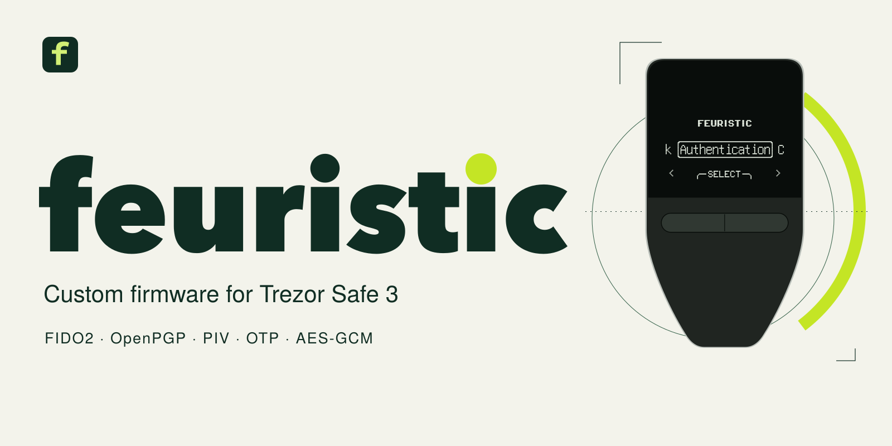
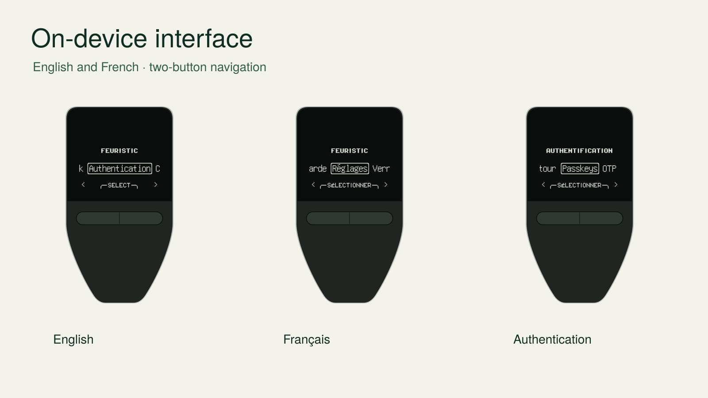

<p align="center"></p>

# feuristic — custom firmware for Trezor Safe 3

[Documentation](https://jean-voila.github.io/feuristic/) · [Download firmware](https://github.com/jean-voila/feuristic/releases) · [Installation](docs/user/install.md) · [Français](docs/user/guide.fr.md)

[](https://github.com/jean-voila/feuristic/actions/workflows/ci.yml)
[](https://jean-voila.github.io/feuristic/)
[](LICENSE)

feuristic replaces the wallet application on a **Trezor Safe 3** with a USB
security key and smart card: **FIDO2 passkeys, OpenPGP, PIV, TOTP/HOTP,
AES-256-GCM and encrypted QR backups**. Configure it on the two buttons and use
standard clients on your computer. No companion account or cloud service.

> **Development firmware.** Core workflows have passed a [physical T2B1/macOS
> campaign](docs/acceptance/campaign-2026-10-21-T2B1-macos.md). Full hardware
> acceptance on both revisions remains unfinished. Use disposable test identities.
>
> **Installing erases the wallet and permanently removes original manufacturer
> attestation.** Back up the wallet first. This independent project is not made,
> endorsed or signed by Trezor Company / SatoshiLabs. The bootloader's
> `UNSAFE, DO NOT USE!` warning remains. There is no cryptocurrency wallet or
> seed migration in feuristic.

## Install in three steps

1. **Identify and download.** Read the internal model with `trezorctl get-features`:
   **T2B1 or T3B1**. Download that model's `.bin` and checksum from
   [Releases](https://github.com/jean-voila/feuristic/releases).
2. **Unlock once and install.** Follow the [installation guide](docs/user/install.md).
   On a backed-up test device, enter the bootloader and confirm its irreversible
   unlock. In **Trezor Suite → Settings → Device → Danger Area → Install custom
   firmware**, select or drag the downloaded `.bin` into the upload box. Confirm
   the device requests. The guide also provides the tested `trezorctl` route.
3. **Set your PIN.** Accept the third-party warning, select English or French,
   create a device PIN and follow the [user guide](docs/user/guide.md).

A firmware binary is uploaded through the **bootloader**, not copied onto the
feuristic OTP import drive. Check the model and SHA-256 before installing.
Pre-releases are listed under [all releases](https://github.com/jean-voila/feuristic/releases).

## Features

| Function | Implemented profile | Standard clients |
|---|---|---|
| Passkeys / security key | FIDO2, WebAuthn, CTAP 2.1, U2F; clientPIN, credentialManagement, credProtect, largeBlobs, hmac-secret | Browsers, libfido2, OpenSSH security keys |
| One-time passwords | TOTP / HOTP, SHA1/SHA256/SHA512, QR import | Codes on-device; `otpauth://` QR images |
| OpenPGP card | OpenPGP Card 3.4, Ed25519 / X25519, RSA-2048 | GnuPG over native CCID / PC/SC |
| PIV | Slots 9A, 9C, 9D, 9E; P-256, RSA-2048 | PIV clients, OpenSC / PKCS#11 where compatible |
| Encryption | AES-256-GCM, device-generated nonces, up to 3584 bytes + 256 bytes AAD | Public ISO 7816 APDU profile |
| Random bytes | ISO 7816 `GET CHALLENGE`, health checks, rate limits | PC/SC clients |
| Identity backup | Encrypted QR sequences; PNG / baseline JPEG restore | Camera and temporary USB mass storage |

Discoverable passkeys are included in encrypted backups and are **exportable**.
Implementation support is not a claim of completed interoperability testing on
every client. See the [protocol references](docs/index.md) and [acceptance register](docs/acceptance/README.md).

## On-device interface



Actual emulator captures, with disposable identities. The device shells are
illustrations. Left/right navigates, both buttons confirms, and holding left
refuses or goes back. Sensitive actions require an explicit confirmation.

## Hardware

| Device | Status |
|---|---|
| **Trezor Safe 3 T2B1** · revision A, STM32F427 | Builds and emulator tests; first physical macOS campaign completed |
| **Trezor Safe 3 T3B1** · revision B, STM32U585 | Builds and emulator tests; physical qualification pending |
| Safe 5, Safe 7, Model T, Model One | Not supported |

Two Safe 3 revisions require different images. Do not infer the model from its
color. [Compatibility details](docs/hardware.md).

## Documentation

- [Install and recover](docs/user/install.md) · [Downloads and verification](docs/downloads.md)
- [English user guide](docs/user/guide.md) · [Guide français](docs/user/guide.fr.md)
- [FIDO2](docs/protocols/fido2.md) · [OpenPGP](docs/protocols/openpgp.md) · [PIV](docs/protocols/piv.md) · [AES-GCM](docs/protocols/aes-gcm-iso7816-v1.md)
- [Architecture](docs/architecture.md) · [Threat model](docs/threat-model.md) · [Backup format](docs/protocols/backup-format-v1.md)
- [Physical test results](docs/acceptance/campaign-2026-10-21-T2B1-macos.md) · [Release checklist](docs/release-checklist.md)

## Build and contribute

```sh
git clone https://github.com/jean-voila/feuristic.git
cd feuristic
make setup
make test-host
make test-c
make emu
make test-functional
make firmware MODEL=T2B1
```

The [build guide](docs/developer/building.md) documents the toolchain and model
selection. CI builds both revisions, runs host/C/emulator tests, standard-client
interop and fuzzing. Tagged candidates pass the release workflow before packaging.

See [contributing](CONTRIBUTING.md), the [pull request policy](CONTRIBUTING.md#pull-request-review)
and [security reporting](SECURITY.md). Editable artwork is in
[assets/design](assets/design/). Protocol and implementation files live in
`src/feuristic/`, `firmware/`, `lib/` and the reviewed `patches/` series.

## License and upstream

GPL-3.0-only. Built on [trezor-firmware](https://github.com/trezor/trezor-firmware)
`core/v2.12.5` with ten exported patches. Upstream components retain their own
licenses; see [LICENSE](LICENSE), [NOTICE](NOTICE) and each release's SBOM and
corresponding source archive.
