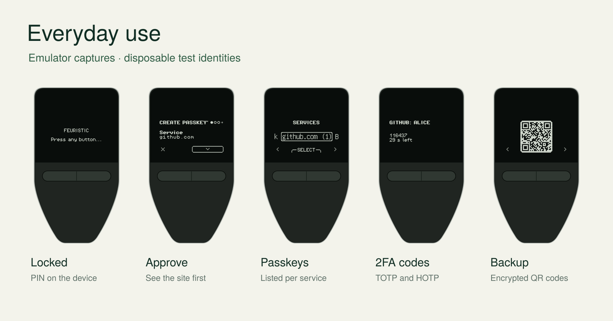

<p align="center"></p>

# feuristic: a security key for your Trezor Safe 3, with passkeys you can back up

[Download](https://github.com/jean-voila/feuristic/releases/latest) · [Install guide](docs/user/install.md) · [User guide](docs/user/guide.md) · [Guide en français](docs/user/guide.fr.md) · [Documentation](https://jean-voila.github.io/feuristic/)

[](https://github.com/jean-voila/feuristic/actions/workflows/ci.yml)
[](https://github.com/jean-voila/feuristic/releases/latest)
[](LICENSE)

feuristic is open-source firmware that turns a **Trezor Safe 3** into a USB
security key. You can sign in to websites with passkeys, read 2FA codes on the
device's own screen, and sign your SSH logins, Git commits and emails. You
confirm every request on the device. It needs no account, app or cloud service.

## Why use it

- **Back up your passkeys.** On a YubiKey and most other security keys, a
  passkey can never leave the key. If you lose the key, you have to register a
  new one on every site. feuristic can save your passkeys in an **encrypted QR
  backup** that you restore onto a Safe 3 running feuristic.
- **See what you approve.** Before you sign in, the screen shows which site is
  asking. A security key without a screen cannot show you this.
- **2FA codes without a phone.** Import a 2FA QR code as an image file. The
  6-digit TOTP or HOTP codes then appear on the device, for up to 32 accounts.
- **Up to 100 passkeys** for any site that accepts a security key or passkey,
  plus classic U2F security-key logins.
- **SSH, Git and email.** Use `ed25519-sk` SSH keys, sign Git commits, and sign
  or decrypt email with GnuPG (OpenPGP card). PIV certificates and AES
  encryption are also available.
- **Private and open.** It needs no account or cloud service. Menus are in
  English and French. The code is GPL-licensed and built reproducibly in CI.

| | feuristic on Safe 3 | Typical security key (e.g. YubiKey) |
|---|---|---|
| Back up and restore passkeys | **Yes**, as an encrypted QR backup | No, by design |
| Screen that names the site | **Yes** | No |
| 2FA codes | Shown on the device | Shown in a companion app |
| PIN entry | On the device for unlocking | On the computer |
| NFC (tap on a phone) | No, USB only | On many models |
| Manufacturer attestation | No | Yes. A few company logins require it. |

A backup is only as safe as its passphrase. Anyone who has both the QR images
and the passphrase can recover your keys, so store them in separate places.

## What it looks like




These are captures from the emulator using test accounts; the device outlines
are illustrations. To navigate, press left or right. Press both buttons to
select, and hold left to go back or refuse.

## Before you install

> [!WARNING]
> - **The device stops being a crypto wallet.** Installing erases the wallet.
>   Before you start, make sure your recovery seed is backed up.
> - **Unlocking is permanent.** Installing requires a one-time bootloader
>   unlock, which permanently removes Trezor's genuine-device attestation.
>   Afterwards, the device shows the standard `UNSAFE, DO NOT USE!` warning that
>   appears for any non-Trezor firmware.
> - **This is an independent project.** It is not made, endorsed or signed by
>   Trezor Company / SatoshiLabs.

**Testing status.** The core features (passkeys, 2FA codes, OpenPGP, PIV, AES,
QR import, power loss) passed a [test campaign on a real T2B1 under
macOS](docs/acceptance/campaign-2026-10-21-T2B1-macos.md). The T3B1 is tested
on the emulator only. Windows, Linux and backup restore with a real camera
remain on the [test plan](docs/acceptance/README.md). Keep a second way to sign
in to your important accounts.

## Install in three steps

1. **Find your model and download it.** Run `trezorctl get-features` and read
   the internal model, **T2B1 or T3B1**; the colour does not tell you. Download
   that model's `.bin` from the [latest release](https://github.com/jean-voila/feuristic/releases/latest)
   and [check its checksum](docs/downloads.md).
2. **Unlock once and install.** Follow the [installation guide](docs/user/install.md).
   Enter the bootloader and confirm the one-time unlock. Then, in **Trezor
   Suite → Settings → Device → Danger Area → Install custom firmware**, select
   the `.bin` file. The guide also covers the `trezorctl` route.
3. **Set up.** Choose English or French, create a device PIN, and follow the
   [user guide](docs/user/guide.md) to add your first passkey.

To go back, install the official firmware from Trezor Suite. The genuine-device
attestation does not come back.

## Hardware

| Device | Status |
|---|---|
| **Trezor Safe 3 T2B1**, revision A (STM32F427) | Supported. Core features tested on a real device. |
| **Trezor Safe 3 T3B1**, revision B (STM32U585) | Supported. Tested in the emulator; hardware tests pending. |
| Safe 5, Safe 7, Model T, Model One | Not supported |

The two Safe 3 revisions need different files. See [compatibility details](docs/hardware.md).

<details>
<summary><b>Technical details: protocols and standard clients</b></summary>

| Function | Implemented profile | Standard clients |
|---|---|---|
| Passkeys / security key | FIDO2, WebAuthn, CTAP 2.1, U2F; clientPIN, credentialManagement, credProtect, largeBlobs, hmac-secret | Browsers, libfido2, OpenSSH security keys |
| One-time passwords | TOTP / HOTP, SHA1/SHA256/SHA512, QR import | Codes on the device; `otpauth://` QR images |
| OpenPGP card | OpenPGP Card 3.4, Ed25519 / X25519, RSA-2048 | GnuPG over native CCID / PC/SC |
| PIV | Slots 9A, 9C, 9D, 9E; P-256, RSA-2048 | PIV clients, OpenSC / PKCS#11 where compatible |
| Encryption | AES-256-GCM, device-generated nonces, up to 3584 bytes + 256 bytes AAD | Public ISO 7816 APDU profile |
| Random bytes | ISO 7816 `GET CHALLENGE`, health checks, rate limits | PC/SC clients |
| Identity backup | Encrypted QR sequences; PNG / baseline JPEG restore | Camera and temporary USB mass storage |

Discoverable passkeys are **exportable** in encrypted backups, and the WebAuthn
backup flags say so. TOTP needs the clock to be set over USB after each power-up
([time sync](docs/protocols/time-sync-v1.md)). Release images are optimized
builds without debuglink. They are signed with upstream's public development
keys and verified against three reproducible Nix builds per model. See the
[protocol references](docs/index.md), [threat model](docs/threat-model.md) and
[acceptance register](docs/acceptance/README.md).

</details>

## Documentation

- [Install and recover](docs/user/install.md) · [Downloads and verification](docs/downloads.md) · [FAQ](docs/faq.md)
- [English user guide](docs/user/guide.md) · [Guide français](docs/user/guide.fr.md)
- [Passkeys](docs/features/passkeys.md) · [2FA codes](docs/features/otp.md) · [Backup](docs/features/backup.md) · [OpenPGP](docs/features/openpgp.md) · [PIV](docs/features/piv.md) · [AES](docs/features/aes.md)
- [Architecture](docs/architecture.md) · [Threat model](docs/threat-model.md) · [Backup format](docs/protocols/backup-format-v1.md)

## Build and contribute

```sh
git clone https://github.com/jean-voila/feuristic.git
cd feuristic
make setup
make test-host
make test-c
make emu
make test-functional
make firmware MODEL=T2B1
```

`make firmware` produces the optimized release image; `make firmware-debug` is
for development only. The [build guide](docs/developer/building.md) covers the
toolchain. CI builds both revisions, runs host, C and emulator tests,
standard-client interop and fuzzing. `tools/capture_screens.py` regenerates the
screen captures above, and [assets/design](assets/design/) holds the editable
artwork.

See [contributing](CONTRIBUTING.md), the [pull request policy](CONTRIBUTING.md#pull-request-review)
and [security reporting](SECURITY.md).

## License and upstream

GPL-3.0-only. Built on [trezor-firmware](https://github.com/trezor/trezor-firmware)
`core/v2.12.5` with the patch series in `patches/`. Upstream components keep
their own licenses; see [LICENSE](LICENSE), [NOTICE](NOTICE) and each release's
SBOM and source archive.
