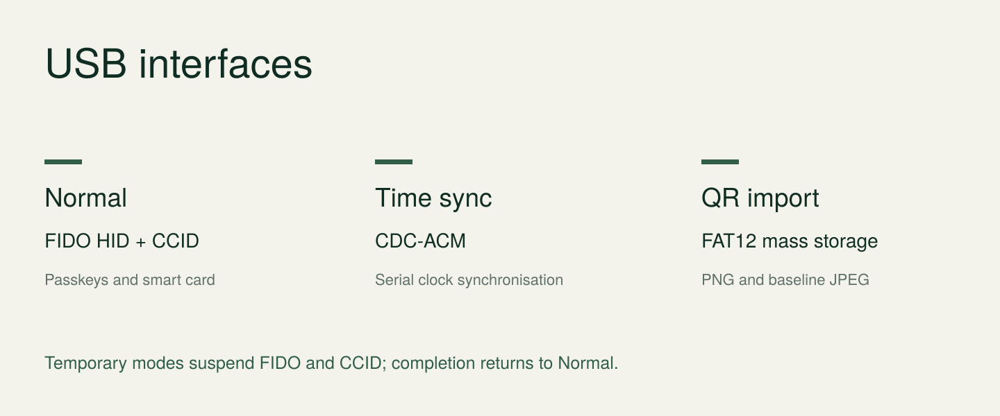

<!-- SPDX-License-Identifier: GPL-3.0-only -->
<!-- Copyright (C) 2026 The feuristic contributors -->

# feuristic — custom firmware for Trezor Safe 3

{ .project-overview width="1600" height="800" }

feuristic replaces the wallet application on a **Trezor Safe 3** with a USB
security key, smart card and one-time password device. It runs on **T2B1 and
T3B1** hardware. Configuration and confirmations happen on the two buttons;
standard clients handle authentication and cryptography.

[Install feuristic](user/install.md){ .md-button .md-button--primary }
[Download firmware](downloads.md){ .md-button }

!!! warning "Development firmware"
    A first physical campaign passed core workflows on T2B1/macOS. The complete
    two-model acceptance matrix is unfinished. Use disposable test identities.
    Installation erases the wallet and permanently removes original manufacturer
    attestation. feuristic is independent of Trezor Company and SatoshiLabs.

## What it supports

| Function | Interface | Get started |
|---|---|---|
| Passkeys and security keys | FIDO2 / WebAuthn, CTAP 2.1, U2F | [FIDO2 guide](features/passkeys.md) |
| OpenPGP signing and decryption | OpenPGP Card 3.4, GnuPG | [OpenPGP guide](features/openpgp.md) |
| Certificates and authentication | PIV, PC/SC, PKCS#11 clients | [PIV guide](features/piv.md) |
| One-time passwords | TOTP / HOTP, QR image import | [OTP guide](features/otp.md) |
| Encryption and random bytes | AES-256-GCM / ISO 7816 APDUs | [AES and RNG guide](features/aes.md) |
| Encrypted identity backup | QR sequences, PNG/JPEG restore | [Backup guide](features/backup.md) |

## Install in three steps

1. **Check your model and download.** Select the exact T2B1 or T3B1 `.bin` from
   [Downloads](downloads.md), then verify its SHA-256 checksum.
2. **Open the bootloader and install.** On a backed-up, disposable device,
   unlock once and select the downloaded file in Trezor Suite, or upload it with
   `trezorctl`. Confirm every request on the device. A firmware file is **not**
   copied onto the OTP import drive.
3. **Create a device PIN.** Accept the third-party boot warning, choose English
   or French, set the PIN and follow the [user guide](user/guide.md).

Read the [complete installation procedure](user/install.md) before step 2.
It explains the irreversible effects, exact button sequence and recovery path.

## Interfaces and controls

{ width="1440" height="600" }

Normal operation exposes FIDO HID and a CCID smart-card reader. Time sync uses a
temporary serial port; QR import uses a temporary FAT12 drive. These modes are
exclusive and return to normal after completion.

- Left: previous. Right: next. Both: confirm.
- Hold left: back or refuse. Destructive actions require a held confirmation.
- The device PIN protects storage. FIDO, OpenPGP and PIV credentials are separate.

## Tested behavior and remaining work

The [physical T2B1 report](acceptance/campaign-2026-10-21-T2B1-macos.md) records
verified signatures, AES-GCM, OTP imports, clock sync and persistence across
updates. The [acceptance register](acceptance/README.md) distinguishes these
results from emulator tests and lists the remaining hardware work.

For implementation details, read the [architecture](architecture.md),
[threat model](threat-model.md) and [protocol references](protocols/fido2.md).
